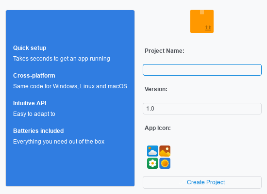
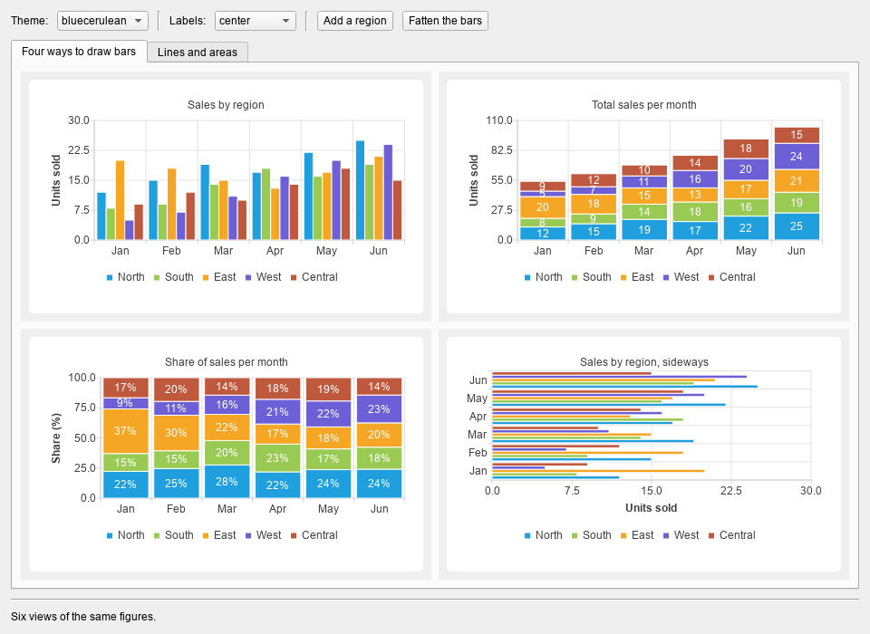
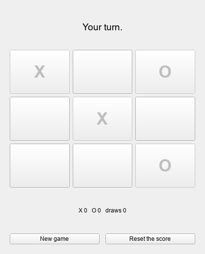
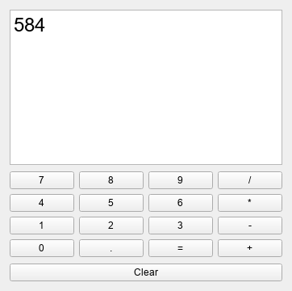
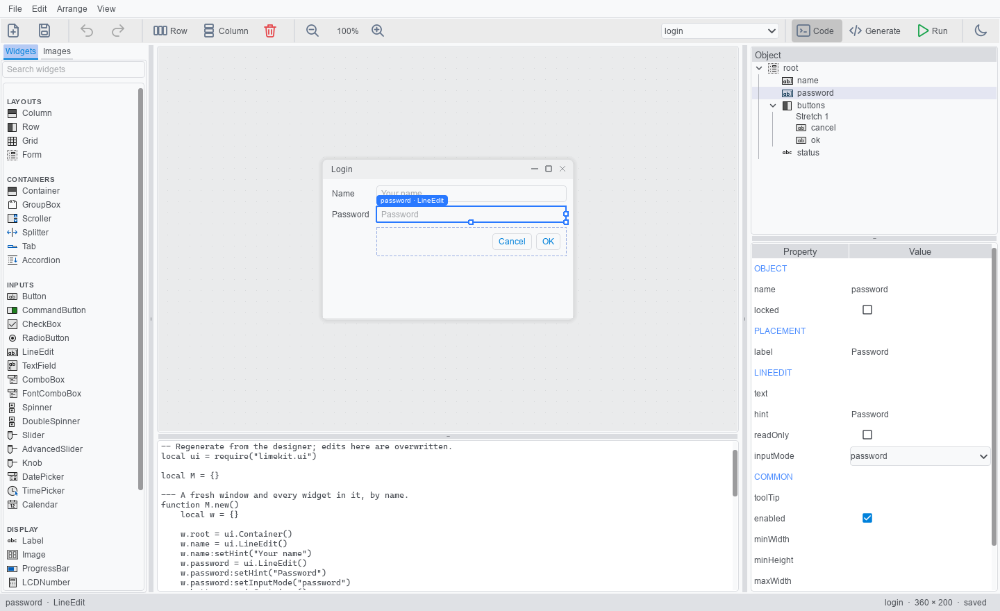

<p align="center">
  
  <h1 align="center">Limer</h1>
  <p align="center">Create, design, run and build desktop apps in Lua.</p>
</p>

<p align="center">
  <a href="https://buymeacoffee.com/omegamsiska"></a>
</p>

<p align="center">
  
</p>

**Limer** is the app you use to make [Limekit](https://github.com/mitosisX/Limekit)
apps. Limekit is the framework your Lua runs on — it is already inside Limer,
so you never install it.

## 📥 Download

1. Go to **[Releases](https://github.com/mitosisX/Limer-Limekit/releases)**
2. Download `Limer-<version>-windows.zip`
3. Unzip it anywhere and run **`Limer.exe`**

That is the whole install. No Python, no packages, no toolchain, no setup
wizard.

> Windows builds are available today. macOS and Linux builds are on the way.

## 🚀 Your first app

Click **New Project**, give it a name, and press **Run**. You have a window.

<p align="center">
  
</p>

Open `scripts/main.lua` in your editor and replace it with:

```lua
local ui = require("limekit.ui")

local window = ui.Window { title = "Hello", size = { 320, 120 } }
local layout = ui.VLayout()
local button = ui.Button("Click me")

button:setOnClick(function(self)
    self:setText("Clicked!")
end)

layout:addChild(button)
window:setLayout(layout)
window:show()
```

Press **Run** again. That is a complete Limekit program.

For more, open any of the forty-plus
[example apps](https://github.com/mitosisX/limekit-demos) — a calculator,
notepad, kanban board, spreadsheet, minesweeper, SQLite browser, charts — and
read the [documentation](https://limekit.readthedocs.io/).

<p align="center">
  
</p>

<p align="center">
  
  &nbsp;&nbsp;
  
</p>

## 🧭 How Limer is laid out

<p align="center">
  
</p>

Limer creates, configures, runs and builds Limekit projects. You write the Lua
in whatever editor you already use. Limekit ships Lua Language Server stubs
describing the whole API, in `python/Lib/site-packages/limekit/runtime/lua/stubs`
inside the Limer folder; pointing your editor's Lua extension at them, for
completion and signatures, is a manual step for now.

- **Left — Project.** The open project's files. Double-click one and it opens
  in whatever your desktop has registered for it.
- **Centre — the home page, and your project's Application and Properties
  tabs.** One toolbar button switches between the home page and your project,
  and it is named after wherever you are not.
- **Designer** (toolbar, or Ctrl+Shift+D) opens the visual designer in a window
  of its own once a project is open.
- **Right — Your Projects.** Everything under your Limekit projects folder.
  Double-click to open.
- **Bottom — Console and Inspector.** While a project is running, the Inspector
  shows its live widget tree: pick a widget, read and edit its properties, or
  run Lua inside it.
- **Ctrl+K — the Limekit API.** Search every class, method, property and event;
  Enter copies the call.

<p align="center">
  
</p>

## 🔍 The Inspector

Run your project and open the Inspector. You see your app's widget tree as it
is *right now* — click any widget to read and change its properties while the
app keeps running, or type Lua and run it inside the app. Your app never opens
that door on its own: Limer has to start it with the Inspector switched on.

<p align="center">
  
</p>

## 🎨 The Designer

The designer is a window of its own, opened with the **Designer** toolbar button
or Ctrl+Shift+D. A canvas wants the whole screen, and in its own window the
designer's shortcuts (Ctrl+X cut, Ctrl+R run the design) no longer collide with
Limer's (Ctrl+X stop, Ctrl+R run the project). Closing it only hides it —
unsaved work is still there when it is reopened — and quitting Limer asks first
if a design has unsaved changes.

Drag widgets from the palette on the left onto the canvas. The canvas holds
real Limekit widgets running inside Limer — not pictures of them and not a
preview — made inert by `ui.DesignSurface`, so a click selects a button instead
of pressing it. The design is drawn inside the window it will become, title bar
included; click the title bar to select the window and edit its title and size
in Properties.

**Layouts, not coordinates.** A widget lands *in a row, column, grid or form*,
at the slot the orange indicator shows, rather than at an x and a y. That is
what makes a designed window survive being resized. A Tab, Splitter or Scroller
is a drop target too: a widget dropped on a Tab gets a page made around it.
Drag a placed widget to move it; drag a selection handle to set its minimum
size; double-click to edit its text. Every command is in the menubar with its
shortcut — File, Edit, Arrange (wrap in a row, column, grid, form, group box,
scroller, splitter or tab; unwrap; change layout; add page, stretch and spacing;
move up, down, to the start and to the end; lock) — and right-click gives the
same commands for the widget under the cursor. A locked widget (Ctrl+L) stays
where it is — it can't be dragged, resized, wrapped or deleted until it is
unlocked — while its properties stay editable. A copied widget travels as Lua
on the clipboard and pastes into any design. On the right, the Outline shows the
tree and Properties edits the selection — its name, where it sits, and every
property its widget declares — both always in view.

**Lists and tables are edited, not typed.** A ComboBox's or ListBox's items
open a list editor, one item per row, with add, remove, reorder and an "edit as
text" box for pasting a whole list. A Table's titles, rows and cell text open a
table editor: one grid whose first row is the column titles. Double-clicking
either widget on the canvas opens its editor too, and the cells generate as
`setCellText` calls after the table has its rows and columns. **Code** (Ctrl+Shift+C) opens the Lua that
would be generated under the canvas, kept current. Ctrl+Z undoes. Delete
deletes when the canvas or the outline has focus, and only then, so it never
takes a widget out of the design while you are in the Properties table.

<p align="center">
  
</p>

**Run** (Ctrl+R) shows the design as a real window: a throwaway project is
written under `design/.preview/` and started through the ordinary project
runner, so the console and the Inspector work on it.

**Designs are saved** to `design/<name>.design.lua` in the project, one per
window, and reopened from the picker in the toolbar. **Generate** writes
`scripts/designed/<name>.lua`: a module whose `new()` builds the window and
returns it with every widget by name, so `main.lua` requires it and wires
handlers on. Each `new()` is a fresh window, so a designed dialog can be opened
as often as it is needed:

    local login = require("designed.login").new()
    login.ok:setOnClick(function() print("hello, " .. login.name:getText()) end)
    login.window:show()

**Generation is one way.** The design file is the source of truth; the designer
never reads the generated module back and never touches `main.lua`. Regenerate
rather than edit. This is the same bargain Qt Designer strikes with `.ui`, and
for the same reason: reconciling generated code with hand-edited code is what
kills these tools.

### Images

The designer's **Images** panel, beside the widget palette, manages the
project's `images/` folder — right where the images get used. Make folders to
keep icons apart from photos, drop image files in from Explorer, Finder or your
file manager, drag images between folders, rename them, delete them (to the
trash). Thumbnails show what each one is.

Every image gets a **name** — its file name made into a Lua identifier — and
Limer keeps `scripts/designed/images.lua` mapping names to paths:

    local images = require("designed.images")
    window:setIcon(images.logo)

Code names *which* image, never *where* it lives. Moving `logo.png` from
`brand/` to `icons/` rewrites that one generated file; `images.logo` keeps
working and nothing else changes. The file follows the folder even when images
are moved outside Limer. Names are unique across the whole tree — a file
brought in under a name already used gets `_2` on the end.

In the designer, pick a window's icon and a widget's image in Properties, or
drag an image from the Images panel straight onto a button, label or image
widget (onto the title bar for the window's icon). Designs store the name, so
generated code reads `w.ok:setIcon(images.save)`. Because Limer owns
that module, `images` cannot be used as a design name.

The Project tree shows each file with your system's own icon for its type,
images as thumbnails, and `.lua` files with Limer's. The toolbar's Light/Dark
button switches the theme, in Limer and the designer alike.

## 📦 Building your app

**Build** on the toolbar packages your project as a standalone app for the
system you are on, ready to hand to someone who has never heard of Limekit:
a folder holding the `.exe`, or one single `.exe` if you tick **Pack into a
single file** -- about 45 MB for a small app, built in about a minute. The
people you give it to install nothing either. Tick **Show a console window**
while testing, to see `print()` output and errors beside the app.

<p align="center">
  
</p>

## ☕ Support

Limer and Limekit are free, and made by one person. If they are useful to you,
you can [buy me a coffee](https://buymeacoffee.com/omegamsiska).

<a href="https://buymeacoffee.com/omegamsiska"></a>

---

## 🧑‍💻 Working on Limer

Limer is itself a Limekit app — about ten thousand lines of Lua in `scripts/`.
Working on it from source is the one place you need Python: install Python
3.12+ and the Limekit framework from its
[repository](https://github.com/mitosisX/Limekit), then from this folder:

```console
python -m limekit .              # run Limer
python -m limekit tests          # run Limer's checks
python packaging/package_portable.py --zip # the release zip (Windows)
```

The release is not a PyInstaller freeze. `package_portable.py` downloads a
pinned, checksum-verified portable CPython, installs Limekit and the exact
dependency versions in `portable-constraints.txt` into it, trims the parts of
Qt that Limekit never uses, and puts a ~100 KB `Limer.exe` in front that starts
it. A real interpreter is what lets Limer run your projects; a frozen Limer has
none to start them with.

The framework side of the designer — `ui.DesignSurface`, `ui.WidgetPalette`
and `sys.Introspect` — lives in Limekit; Limer owns the model, the files and the
generator (`scripts/app/core/design_model.lua`), whose checks are in `tests/`.

### Regenerating the API index

`scripts/data/api_index.lua` is generated from Limekit's registry — the same
source its LSP stubs and manifest come from. The generator lives in the Limekit
repository, not this one: Limer ships no Python, and nothing inside it should
suggest otherwise. Re-run it from there whenever Limekit gains or loses API:

```
python tools/generate_api_index.py [path-to-Limer]      # write it
python tools/generate_api_index.py --check              # fail if stale
```

It finds Limer from the argument, then `$LIMER_REPO`, then a sibling checkout.

## 📜 License

GPLv3. Copyright © 2025 Omega Msiska.
